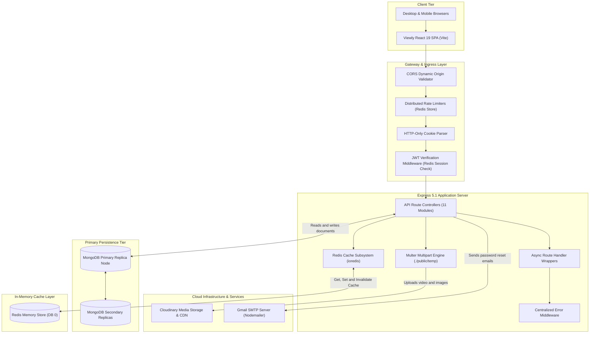
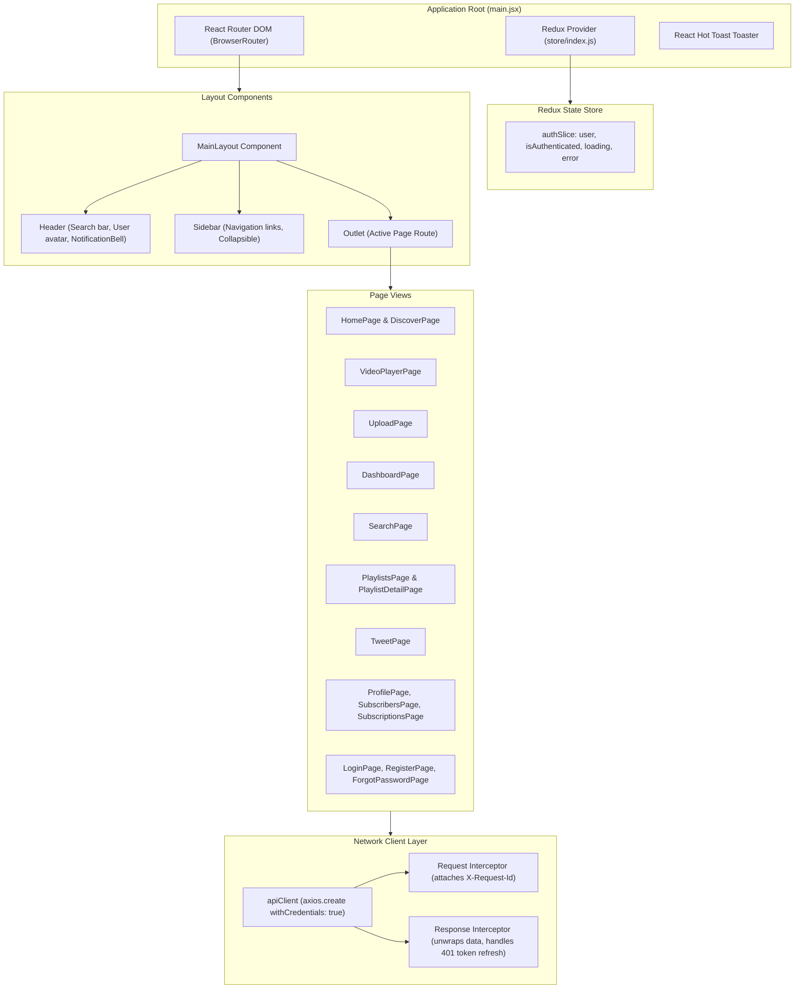

# VidNest / Viewly — System Overview & Architecture Topology

**Part of the [VidNest Documentation Series](./README.md)**  
**Author:** Prajjwal ([GitHub](https://github.com/Prajjwal2051))  
**Project:** VidNest (Express Backend API) / Viewly (React Frontend Client)  

---

## 1. Executive Summary

VidNest (client branded as **Viewly**) is an enterprise-grade full-stack video-sharing and creator platform. It provides video streaming, metadata management, channel subscriptions, social engagement (likes, comments, tweets), channel analytics, and intelligent multi-tier caching.

### Core Architectural Pillars
- **Microservice-Ready Monolith**: A modular REST API built on Express 5.1 with isolated routing, centralized error propagation, and declarative middleware.
- **Asynchronous Media Processing**: Local disk spooling via Multer combined with Cloudinary cloud storage and automated video transcoding.
- **Multi-Tier Performance Layer**: Low-latency read paths leveraging Redis caching for query caching, session stores, rate limiting, and atomic view counters.
- **Resilient Security Pipeline**: Dual-token authentication (short-lived access tokens + long-lived refresh tokens in HTTP-only cookies), bcrypt password hashing, and sliding-window rate limiting.

---

## 2. Technology Stack Breakdown

| Layer | Technology | Version | Purpose |
| :--- | :--- | :--- | :--- |
| **Backend Runtime** | Node.js (ES Modules) | v24.x | Event-driven non-blocking I/O runtime |
| **HTTP Framework** | Express.js | 5.1.0 | RESTful API routing and middleware pipeline |
| **Primary Datastore** | MongoDB & Mongoose | 8.19.0 | Document database & Object Document Mapper (ODM) |
| **Pagination Engine** | mongoose-aggregate-paginate-v2 | 1.1.4 | High-performance cursor/offset aggregation pagination |
| **In-Memory Caching** | Redis & ioredis | 5.10.0 / 5.11.0 | Distributed key-value cache, view counters & session storage |
| **Rate Limiter** | express-rate-limit & rate-limit-redis | 8.3.1 / 4.3.1 | Distributed IP and user-level abuse protection |
| **Media Transcoding** | Cloudinary SDK v2 | 2.7.0 | Cloud storage, media delivery, auto-formatting & CDN |
| **File Spooling** | Multer | 2.0.2 | Multipart form-data handling with disk spooling |
| **Authentication** | JWT (`jsonwebtoken`) & `bcrypt` | 9.0.2 / 6.0.0 | Dual-token authentication & salted password hashing |
| **Email Service** | Nodemailer | 7.0.12 | SMTP service for secure password reset workflows |
| **Frontend Runtime** | React & React DOM | 19.2.0 | Declarative component UI library |
| **Frontend Tooling** | Vite | 7.2.4 | Modern bundler and fast HMR development server |
| **Styling & Components**| Tailwind CSS & shadcn/ui | 3.4.17 | Utility styling and accessible Radix UI primitives |
| **State Management** | Redux Toolkit & React-Redux | 2.11.0 / 9.2.0 | Centralized client-side authentication and user state |
| **Client Routing** | React Router DOM | 7.10.0 | Client-side Single Page Application routing |
| **HTTP Client** | Axios | 1.13.2 | Interceptor-driven HTTP client with auto-refresh |
| **Video Player** | React Player | 3.4.0 | Adaptive HTML5 media player component |
| **Analytics Charts** | Recharts | 3.6.0 | Creator analytics charts & growth visualizations |
| **Security / Sanitization**| DOMPurify | 3.3.1 | Client-side XSS protection against malicious strings |

---

## 3. High-Level Architecture Topology

---

## 4. Backend Layered Architecture

```mermaid
graph TD
    subgraph Presentation["Presentation & Routing Layer"]
        R1["User Routes (/api/v1/users)"]
        R2["Video Routes (/api/v1/videos)"]
        R3["Comment Routes (/api/v1/comments)"]
        R4["Like Routes (/api/v1/like)"]
        R5["Subscription Routes (/api/v1/subscription)"]
        R6["Search Routes (/api/v1/search)"]
        R7["Tweet Routes (/api/v1/tweets)"]
        R8["Playlist Routes (/api/v1/playlists)"]
        R9["Dashboard Routes (/api/v1/dashboard)"]
        R10["Notification Routes (/api/v1/notifications)"]
        R11["Health Routes (/api/v1/health)"]
    end

    subgraph Middleware["Middleware Pipeline"]
        M1["CORS Origin Validation"]
        M2["General & Auth Rate Limiting"]
        M3["express.json & urlencoded (16kb payload limit)"]
        M4["cookieParser"]
        M5["verifyJWT (Session & Token validation)"]
        M6["Multer Disk Storage (./public/temp)"]
        M7["Centralized errorHandler & notFoundHandler"]
    end

    subgraph Controllers["Controller Business Logic"]
        C1["user.controller.js"]
        C2["video.controller.js"]
        C3["comment.controller.js"]
        C4["like.controller.js"]
        C5["subscription.controller.js"]
        C6["search.controller.js"]
        C7["tweet.controller.js"]
        C8["playlist.controller.js"]
        C9["dashboard.controller.js"]
        C10["notification.controller.js"]
        C11["health.controller.js"]
    end

    subgraph Persistence["Data & Service Access Layer"]
        MongooseODM["Mongoose ODM Models"]
        RedisModule["Redis Helper API (getCache, setCache, counters)"]
        CloudinaryUtil["Cloudinary Upload & Delete Service"]
        EmailUtil["Nodemailer Email Service"]
    end

    Presentation --> Middleware --> Controllers --> Persistence
```

---

## 5. Frontend Architecture & State Hierarchy

---

*Continue to [02. Diagnostic Audit & Health Report](./02-diagnostic-audit.md)*
