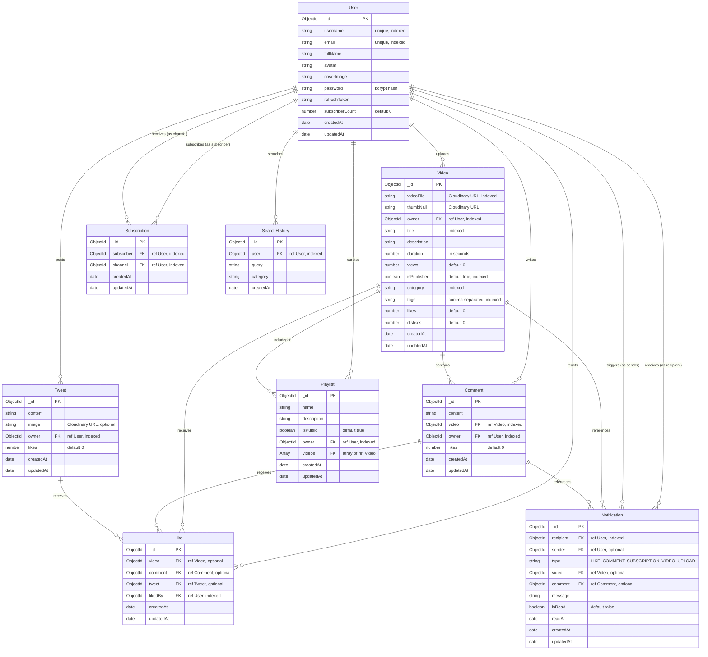

# VidNest / Viewly — Data Architecture & Entity-Relationship Model

**Part of the [VidNest Documentation Series](./README.md)**  
**Author:** Prajjwal ([GitHub](https://github.com/Prajjwal2051))  

---

## 1. Overview & Data Modeling Strategy

VidNest utilizes MongoDB as its primary persistence datastore, managed via Mongoose ODM (v8.19.0). The database architecture balances normalization (for consistency in subscriptions, likes, and playlists) with selective denormalization (for fast read paths such as subscriber counts, video view counters, and like counts).

### Core Database Capabilities
- **Schema Validation**: Strict Mongoose schema typing with required fields, enums, and default values.
- **Aggregation Pagination**: High-performance pagination powered by `mongoose-aggregate-paginate-v2` for video discovery and search.
- **Atomic Counters**: Use of MongoDB `$inc` operators for high-throughput counters (views, likes, subscriber counts).
- **Secondary Indexing**: Compound and single-field indexing on frequently queried keys (`owner`, `video`, `channel`, `subscriber`, `category`, `tags`).

---

## 2. Entity-Relationship Diagram (ERD)

---

## 3. Detailed Schema Specifications

### 3.1 User Schema (`src/models/user.model.js`)
Stores authentication credentials, profile images, and channel metrics.
- `username`: String (required, unique, lowercase, trimmed, indexed).
- `email`: String (required, unique, lowercase, trimmed, indexed).
- `fullName`: String (required, trimmed, indexed).
- `avatar`: String (required Cloudinary or auto-generated UI Avatar URL).
- `coverImage`: String (optional Cloudinary URL).
- `watchHistory`: Array of `ObjectId` referencing `Video`.
- `password`: String (required, bcrypt salted hash, excluded from default selects).
- `refreshToken`: String (optional, JWT refresh token hash).
- `subscriberCount`: Number (default: 0, atomically updated on subscribe/unsubscribe).
- **Hooks & Methods**:
  - `pre("save")`: Hashes password using `bcrypt.hash(password, 10)` when modified.
  - `isPasswordCorrect(password)`: Compares plaintext with stored bcrypt hash.
  - `generateAccessToken()`: Signs JWT containing `_id`, `email`, `username`, `fullName`.
  - `generateRefreshToken()`: Signs long-lived JWT containing `_id`.

---

### 3.2 Video Schema (`src/models/video.model.js`)
Stores video file storage references, metadata, and analytics.
- `videoFile`: String (required, unique, indexed Cloudinary URL).
- `thumbNail`: String (Cloudinary URL).
- `owner`: `ObjectId` referencing `User` (indexed).
- `title`: String (required, indexed for search).
- `description`: String (optional).
- `duration`: Number (calculated in seconds from Cloudinary metadata).
- `views`: Number (default: 0, atomically incremented via `$inc`).
- `isPublished`: Boolean (default: true, indexed).
- `tags`: String (comma-separated, indexed for regex search).
- `category`: String (required, indexed for categorical filtering).
- `likes`: Number (default: 0).
- `dislikes`: Number (default: 0).
- **Plugins**: `videoSchema.plugin(mongooseAggregatePaginate)` enabled.

---

### 3.3 Comment Schema (`src/models/comment.model.js`)
Stores viewer commentary on uploaded videos.
- `content`: String (required, sanitized).
- `video`: `ObjectId` referencing `Video` (required, indexed).
- `owner`: `ObjectId` referencing `User` (required, indexed).
- `likes`: Number (default: 0).

---

### 3.4 Like Schema (`src/models/like.model.js`)
Polymorphic interaction schema representing user reactions across multiple entities.
- `video`: `ObjectId` referencing `Video` (optional).
- `comment`: `ObjectId` referencing `Comment` (optional).
- `tweet`: `ObjectId` referencing `Tweet` (optional).
- `likedBy`: `ObjectId` referencing `User` (required, indexed).
- **Compound Indexes**: Unique index constraints preventing duplicate likes per user per entity:
  - `{ video: 1, likedBy: 1 }`
  - `{ comment: 1, likedBy: 1 }`
  - `{ tweet: 1, likedBy: 1 }`

---

### 3.5 Subscription Schema (`src/models/subscription.model.js`)
Represents directional channel follows between two user accounts.
- `subscriber`: `ObjectId` referencing `User` (the follower, indexed).
- `channel`: `ObjectId` referencing `User` (the followed creator, indexed).
- **Compound Index**: `{ subscriber: 1, channel: 1 }` with unique constraint.

---

### 3.6 Tweet Schema (`src/models/tweet.model.js`)
Community microblogging post model.
- `content`: String (required).
- `image`: String (optional Cloudinary URL).
- `owner`: `ObjectId` referencing `User` (required, indexed).
- `likes`: Number (default: 0).

---

### 3.7 Playlist Schema (`src/models/playlist.model.js`)
Curated video collection model.
- `name`: String (required).
- `description`: String (optional).
- `isPublic`: Boolean (default: true).
- `owner`: `ObjectId` referencing `User` (required, indexed).
- `videos`: Array of `ObjectId` referencing `Video`.

---

### 3.8 Notification Schema (`src/models/notofication.model.js`)
User notification document.
- `recipient`: `ObjectId` referencing `User` (required, indexed).
- `sender`: `ObjectId` referencing `User` (optional).
- `type`: String (enum: `["LIKE", "COMMENT", "SUBSCRIPTION", "VIDEO_UPLOAD"]`, required).
- `video`: `ObjectId` referencing `Video` (optional).
- `comment`: `ObjectId` referencing `Comment` (optional).
- `message`: String (required).
- `isRead`: Boolean (default: false).
- `readAt`: Date (optional).

---

*Continue to [04. Caching & Performance Architecture](./04-caching-and-performance.md)*
