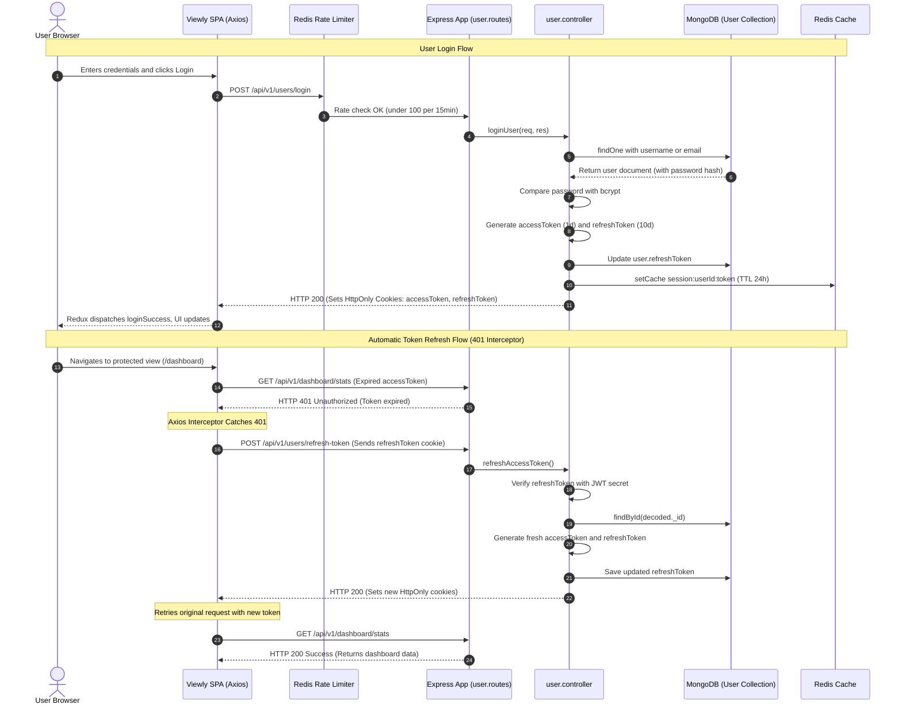
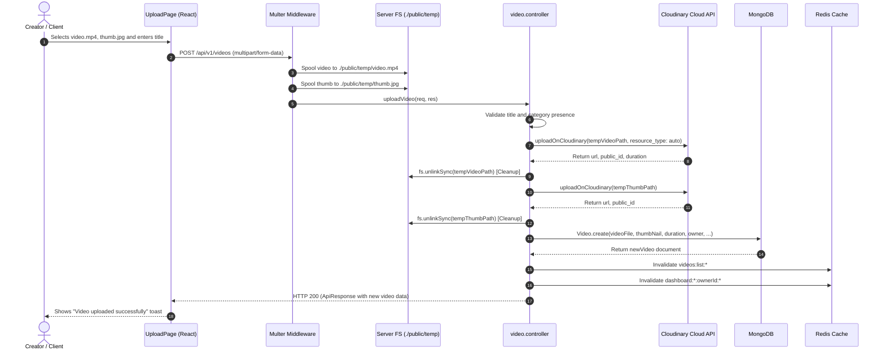
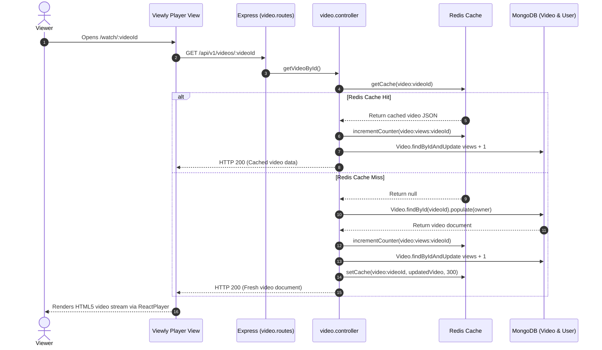
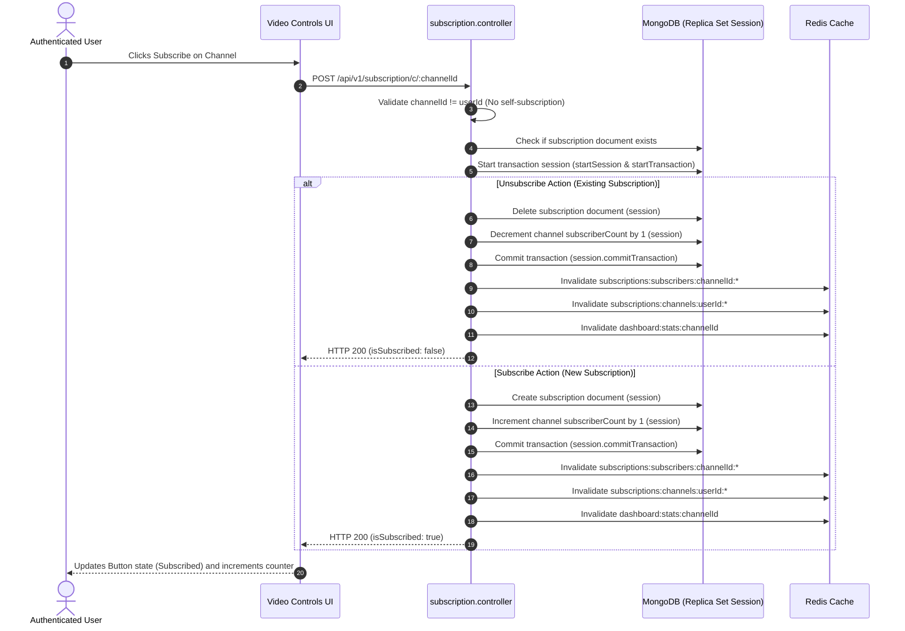
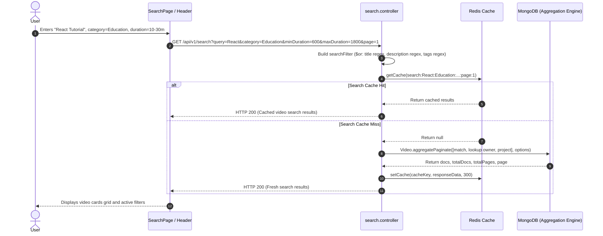

# VidNest / Viewly — Mermaid Sequence Diagrams

**Part of the [VidNest Documentation Series](./README.md)**  
**Author:** Prajjwal ([GitHub](https://github.com/Prajjwal2051))  

This document contains full sequence diagrams modeling the critical interactions between client components, Express middleware, controllers, MongoDB, Redis, and external cloud services.

---

## 1. Dual-Token Authentication & Refresh Rotation

Illustrates user login, JWT cookie generation, Redis session storage, and transparent token refresh via Axios interceptors on HTTP 401.

---

## 2. Video Upload & Media Ingestion Pipeline

Illustrates multipart file ingestion, Multer disk spooling, Cloudinary upload, duration calculation, and database persistence.

---

## 3. Video Playback & Atomic View Count Increment

Illustrates Redis read-through caching for video playback and atomic view count increments across Redis and MongoDB.

---

## 4. Atomic Channel Subscription (MongoDB Transaction + Redis Purge)

Illustrates atomic follow/unfollow operations using MongoDB replica set transactions and cache invalidation.

---

## 5. Advanced Video Search & Aggregation Pipeline

Illustrates multi-parameter video searching with text regex matching, duration ranges, sorting, and Redis caching.

---

*Continue to [07. Complete API Reference](./07-api-reference.md)*
