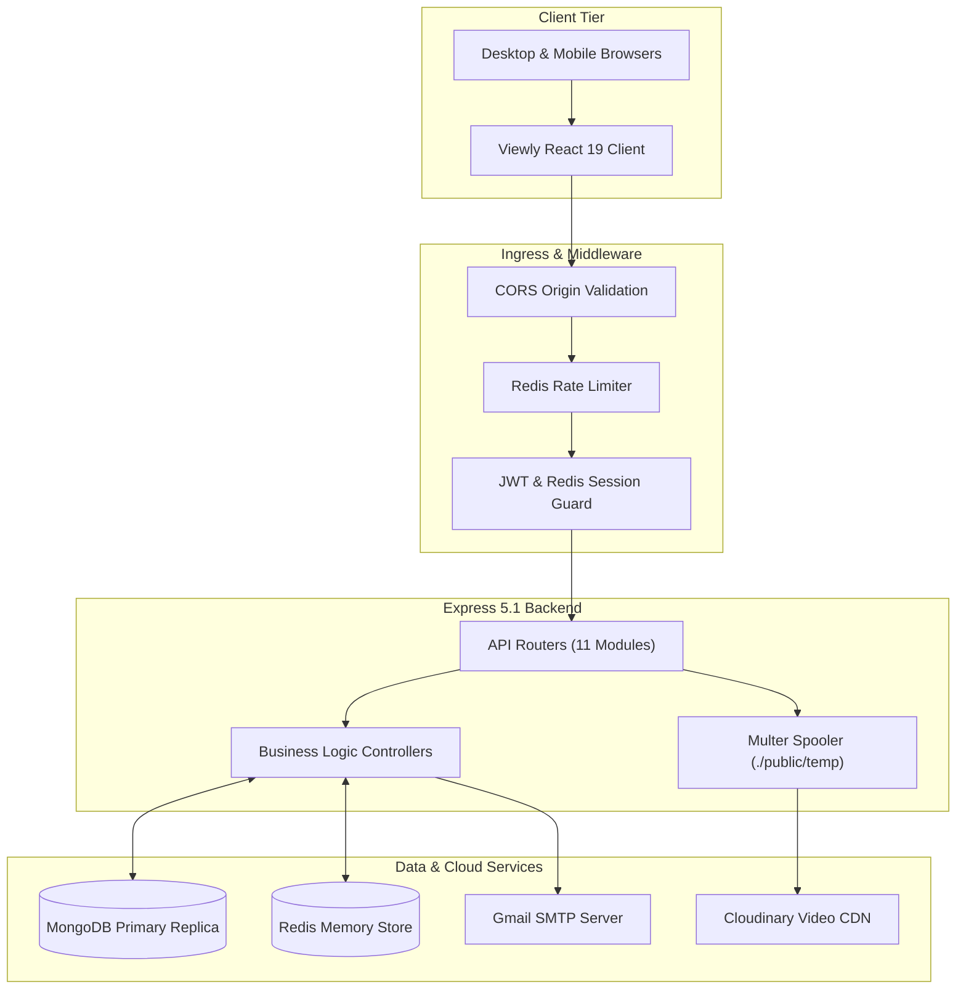

# VidNest (Viewly) — Engineering & Architecture Documentation

**Author:** Prajjwal ([GitHub](https://github.com/Prajjwal2051))  
**Project:** VidNest (Express Backend API) / Viewly (React 19 Frontend Client)  
**Version:** 1.0.0  

Welcome to the official technical documentation for the VidNest / Viewly platform. The documentation has been divided into modular, topic-focused guides:

---

## Documentation Directory

| Document | Description |
| :--- | :--- |
| **[01. System Overview & Architecture Topology](./01-system-overview.md)** | Executive summary, high-level architecture diagram, layered backend structure, and frontend component hierarchy. |
| **[02. Diagnostic Audit & Quality Health Report](./02-diagnostic-audit.md)** | Codebase health check, findings, static analysis results, and 8 critical defects identified with remediation steps. |
| **[03. Data Architecture & Entity-Relationship Model](./03-data-architecture.md)** | Database schemas, MongoDB models, indexing strategies, and Mermaid Entity-Relationship Diagram (ERD). |
| **[04. Caching & Performance Architecture](./04-caching-and-performance.md)** | Redis multi-tier caching, key namespace directory, TTL policies, atomic view counters, and cache invalidation matrix. |
| **[05. Detailed User Flows](./05-user-flows.md)** | Step-by-step lifecycle flows: authentication, video upload, streaming, social engagement, and creator analytics. |
| **[06. Mermaid Sequence Diagrams](./06-sequence-diagrams.md)** | Validated sequence diagrams: dual-token auth, video ingestion, view count increments, atomic subscriptions, and search pipelines. |
| **[07. Complete API Reference](./07-api-reference.md)** | Complete endpoint directory covering all 11 router modules with HTTP methods, parameters, and access levels. |
| **[08. Deployment & Environment Runbook](./08-deployment-and-environment.md)** | `.env` configuration guide, local replica set setup, and production deployment on Render and Vercel. |

---

## High-Level Architecture Glance



---

## System Health Overview

```
[SYSTEM SCAN SUMMARY]
Backend Source Files   : 32 JavaScript files  --> Syntax Check: PASS (node --check)
Backend Dependencies   : 549 npm packages     --> Installation: PASS
Backend Test Suites    : 0 test suites        --> Status: NO UNIT TESTS FOUND
Frontend Source Files  : 65 React JSX/JS files--> Syntax Check: PASS
Frontend Dependencies  : 432 npm packages     --> Installation: PASS
Frontend Build         : Vite Production      --> Status: PASS (fixed tailwind.config.js)
Frontend Lint          : ESLint 9 Flat Config --> Status: 58 Warnings/Errors (Unused variables)
```

For detailed findings and remediation, read the **[Diagnostic Audit Report](./02-diagnostic-audit.md)**.
